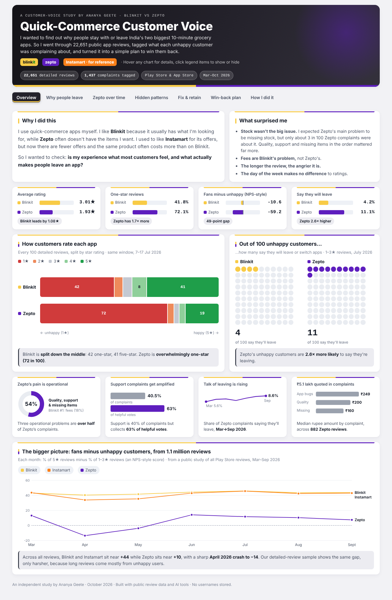
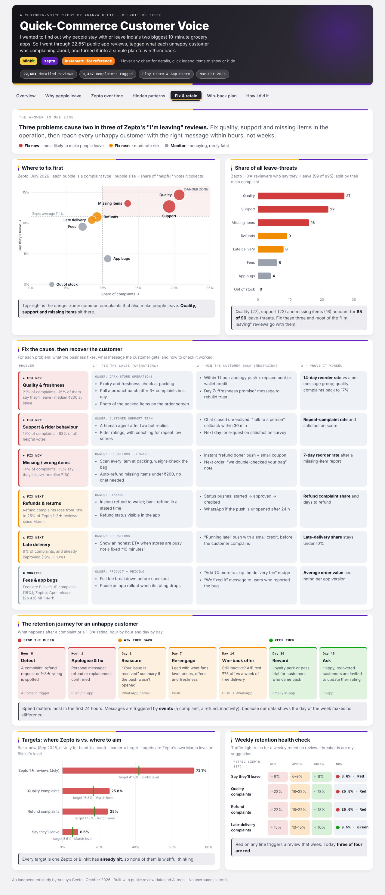

# Quick-Commerce Customer Voice: Blinkit vs Zepto

**Why do people stay with or leave India's 10-minute grocery apps, and how could an app win them back?**

An independent study by **Ananya Geete** · October 2026

👉 **Live dashboard:** open `index.html`, or visit the GitHub Pages link in the About section of this repo.

---

## Why I did this

I use quick-commerce apps myself. I like **Blinkit** because it usually has what I'm looking for, while **Zepto** often doesn't have the items I want. I used to like **Instamart** for its offers, but now there are fewer offers and the same product often costs more than on Blinkit.

So I wanted to check: **is my experience what most customers feel, and what actually makes people leave an app?**

## What I found

| | Blinkit | Zepto |
|---|---|---|
| Average rating (same week, July 2026) | **3.0★** | **1.9★** |
| One-star reviews | about 4 in 10 | about 7 in 10 |
| Unhappy customers who say they'll leave | **4 in 100** | **11 in 100** |
| Biggest complaint | Fees & prices | Product quality |

1. **Zepto's unhappy customers are almost 3× more likely to say they're leaving.** When they name where they're going, Blinkit comes up most.
2. **Zepto's problems are about the order experience**: product quality, customer support and missing items make up over half of its complaints. **Blinkit's biggest complaint is fees.**
3. **Three problems cause two out of three "I'm leaving" reviews** on Zepto: quality, support and missing items. Fixing those gives the biggest result.
4. **Talk of leaving is rising on Zepto**, from about 6 in 100 unhappy reviews in March to about 9 in 100 in September.
5. **What surprised me:** I expected missing stock to be Zepto's main problem, but only about 3 in 100 complaints were about it. The data told a different story from my own experience.

## My win-back plan

For each main problem, I suggest a simple plan: **fix the cause** in operations, **win the customer back** with the right message at the right time, and **measure** whether it worked.

| Problem | Fix the cause | Win them back | How to check it worked |
|---|---|---|---|
| Quality & freshness | Freshness check while packing | Apology + replacement or credit within 1 hour | Do they order again within 14 days? |
| Support & riders | A real person after two bot replies | Call back within 30 minutes | Fewer repeat complaints |
| Missing / wrong items | Check every item before dispatch | Automatic refund + small coupon | Do they order again within 7 days? |
| Customers about to leave | — | A/B test: ₹75 off vs a week of free delivery | How many come back |

**A/B test** = send two versions of a message to two similar groups and keep the one that works better, with a third group that gets no message so the difference is clear.

## How I did it

1. **Collected** about 22,600 public Google Play and App Store reviews from open datasets shared on GitHub (see Credits).
2. **Cleaned** them: kept reviews with at least 6 words, removed duplicates and all usernames. 22,651 reviews left.
3. **Compared fairly**: both apps over the same days (7–17 July 2026): 1,057 Blinkit and 1,147 Zepto reviews.
4. **Tagged complaints with an AI tool**: each of the 1,437 unhappy reviews (1–3 stars) got one main complaint tag, using the rules in [`complaint_tagging_rules.md`](complaint_tagging_rules.md), plus a flag if the person said they would leave.
5. **Checked the tags**: a second, separate tagging round on 120 reviews matched about 97 times in 100, and my results line up with a bigger public study of 1.1 million reviews.
6. **Built the dashboard** and turned the findings into the win-back plan.

### Simple definitions
- **NPS-style score**: % of 5★ reviews minus % of 1–3★ reviews (happy minus unhappy).
- **"Say they'll leave"**: unhappy reviews that mention uninstalling, switching apps or never ordering again. This is what people *say*, not confirmed app deletions.

## What's in this repo

| File | What it is |
|---|---|
| `index.html` | The interactive dashboard (works on phone and computer) |
| `results_summary_tables.xlsx` | Summary tables behind every chart (one sheet per chart) |
| `dashboard_*.png` | Screenshots of the dashboard |
| `complaint_tagging_rules.md` | The rules used to tag each complaint |

The raw review text is **not** included here. It belongs to the original dataset authors and app-store users, so please download it from the sources below.

## Limitations
- People mostly write long reviews when they're unhappy, so reviews are more negative than the full customer base.
- Blinkit data covers 7–17 July 2026 only, so the head-to-head comparison uses that week. Zepto trends cover March–September 2026.
- Reviews are in English only.

## What I'd do next
- Run a short customer survey to understand *why* people actually switch.
- Track whether Zepto's rating improves after each app update.
- Add Swiggy Instamart to the main comparison.

## Credits
- Zepto reviews: [the-machine-learner/zepto-review-discovery-engine](https://github.com/the-machine-learner/zepto-review-discovery-engine)
- Blinkit reviews: [Ruchika2426/BlinkitReviewAnalysis](https://github.com/Ruchika2426/BlinkitReviewAnalysis)
- Public study of 1.1M reviews and tagging rules (MIT License): [kaasyapv/Quick-Commerce-NPS-Benchmark-from-App-Reviews](https://github.com/kaasyapv/Quick-Commerce-NPS-Benchmark-from-App-Reviews)

Built with public review data and AI tools. No usernames are stored.
